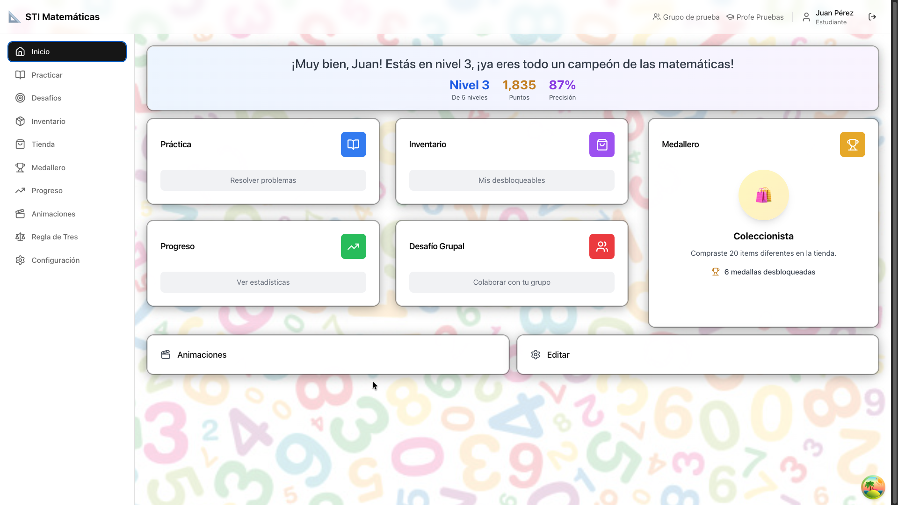
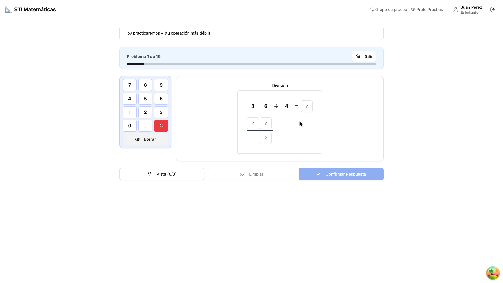
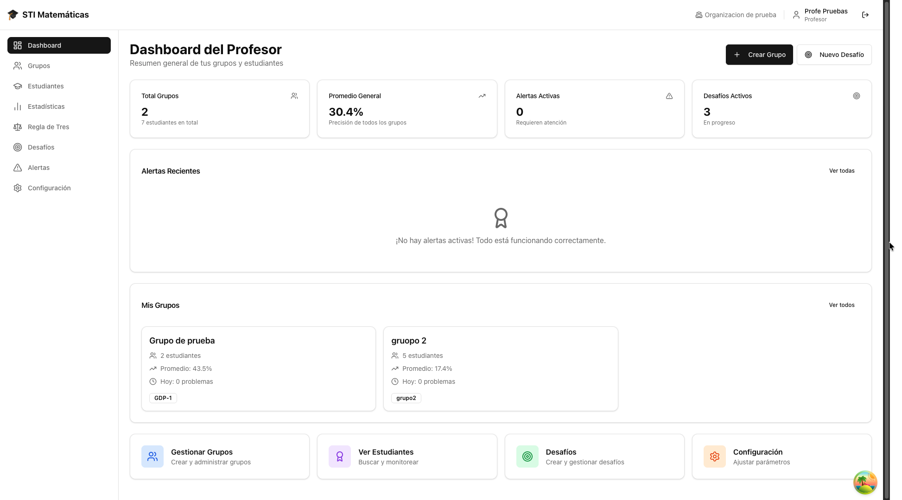

# Sistema de Tutoría Inteligente (STI) para operaciones con números decimales

Sistema web de tutoría inteligente que ayuda a estudiantes panameños de sexto grado a practicar operaciones con números decimales (suma, resta, multiplicación y división). El sistema adapta la dificultad de cada práctica al desempeño del estudiante y le da al docente un panel para seguir el progreso de su grupo.

Se desarrolló como trabajo de graduación de la Licenciatura en Ingeniería de Software de la Universidad Tecnológica de Panamá (UTP), Facultad de Ingeniería de Sistemas Computacionales, y se validó con estudiantes reales en una escuela pública panameña.


> **Estado del proyecto.** La versión presentada en la tesis está etiquetada como `v1.0-tesis`. Durante la tesis se trabajó con un alcance acotado (operaciones con decimales de sexto grado), y actualmente el sistema se está reestructurando para volverlo modular y poder incorporar nuevos temas. La infraestructura de producción usada durante la validación se dio de baja al concluir el proyecto, por lo que **no hay una demo en línea por ahora**.

---

## Contenido

- [Qué hace](#qué-hace)
- [Qué lo hace adaptativo](#qué-lo-hace-adaptativo)
- [Resultados de la validación](#resultados-de-la-validación)
- [Capturas](#capturas)
- [Arquitectura](#arquitectura)
- [Estructura del repositorio](#estructura-del-repositorio)
- [Instalación local](#instalación-local)
- [Pruebas](#pruebas)
- [Despliegue](#despliegue)
- [Privacidad y seguridad](#privacidad-y-seguridad)
- [Hoja de ruta](#hoja-de-ruta)
- [Autor](#autor)

---

## Qué hace

### Para el estudiante

- **Prueba diagnóstica inicial** de ocho problemas que asigna un nivel (1 a 5) en cada operación.
- **Prácticas generadas automáticamente**: el estudiante presiona "Practicar" y el sistema decide qué operaciones incluir, en qué proporción y con qué dificultad.
- **Cuadrículas de resolución** que imitan el procedimiento en papel (llevadas, productos parciales, división paso a paso) y un teclado virtual pensado para tabletas.
- **Pistas en tres niveles**: estrategia general, paso a paso y una pista generada por el modelo de lenguaje que orienta hacia el error cometido sin revelar la respuesta.
- **Animaciones paso a paso** que muestran la resolución completa cuando se agotan los tres intentos de un problema.
- **Enunciados narrativos** según el tema elegido (piratas, astronautas, magos, caballeros, vaqueros o inventores), que presentan cada operación dentro de una historia.
- **Gamificación sin rankings**: puntos, una tienda de 62 artículos estéticos (temas, fondos, colores, música y efectos), 25 medallas y desafíos grupales cooperativos.

### Para el docente

- Gestión de grupos y estudiantes, incluida la importación desde Excel.
- Configuración de la práctica por grupo: operaciones, niveles, rangos numéricos, decimales y pistas habilitadas.
- Estadísticas del grupo: perfiles de aprendizaje, niveles por operación, actividad y precisión semanal.
- Alertas automáticas: estudiantes rezagados, inactivos, estancados, sobresalientes, con ascensos rápidos o con patrones de respuesta anómalos.
- Un análisis pedagógico del grupo, generado por el modelo de lenguaje bajo demanda.
- Desafíos grupales con metas colectivas y recompensas.

### Para el administrador

- Panel protegido para crear escuelas y usuarios, importar y exportar datos y reentrenar los modelos de Machine Learning.

---

## Qué lo hace adaptativo

El sistema combina reglas pedagógicas, modelos de Machine Learning y un modelo de lenguaje. Cada uno cumple una función distinta:

| Componente | Técnica | Qué hace |
|---|---|---|
| Diagnóstico y niveles | Reglas | Asigna un nivel por operación, de modo que un estudiante puede estar en nivel 4 en sumas y en nivel 2 en multiplicaciones. |
| Prerrequisitos | Reglas | Habilita la multiplicación y la división solo cuando el estudiante domina las operaciones de las que dependen. |
| Generación de la práctica | Reglas | Concentra la mayor parte de los problemas en la operación más débil y ajusta la proporción entre problemas fáciles y desafiantes según el nivel. |
| Ajuste de nivel | Reglas | Sube de nivel tras una racha de aciertos consecutivos y baja si la precisión de la sesión cae por debajo de 50%. |
| Perfiles de aprendizaje | **K-means** (scikit-learn) | Agrupa a los estudiantes de cada escuela en cuatro perfiles (rápido y preciso, cuidadoso y metódico, impulsivo, en desarrollo) y adapta la racha necesaria para subir de nivel (de 7 a 15 aciertos). |
| Probabilidad de avance | **Regresión logística** (scikit-learn) | Estima la probabilidad de que el estudiante suba de nivel en las próximas tres sesiones y se la muestra al docente. |
| Tipo de error | Reglas | Clasifica cada respuesta incorrecta (desalineación de decimales, punto mal colocado, operación confundida, orden invertido, error de tabla o cálculo general). |
| Contenido generado | **DeepSeek** (API) | Genera enunciados narrativos (con verificación de que contengan exactamente los números del problema), la pista de nivel 3 a partir del tipo de error, mensajes motivacionales y análisis de la práctica y del grupo. |

Los modelos de Machine Learning se reentrenan cada día con los datos acumulados. Mientras no hay datos suficientes, el sistema usa reglas heurísticas de respaldo.

| Modelo de DeepSeek | Uso |
|---|---|
| `deepseek-chat` | Enunciados narrativos, pistas de nivel 3 y mensajes motivacionales |
| `deepseek-reasoner` | Análisis posterior a cada práctica y análisis del grupo |

---

## Resultados de la validación

El sistema se validó entre mayo y julio de 2026 con estudiantes de tres secciones de sexto grado de una escuela pública panameña.

| Indicador | Resultado |
|---|---|
| Estudiantes participantes | 74 (65 completaron al menos una práctica) |
| Sesiones de práctica completadas | 710, en dos meses |
| Pre-test → post-test (n = 63, de 0 a 8 aciertos) | 1.83 → 2.56 aciertos en promedio |
| Prueba de Wilcoxon | p = 0.0012; tamaño del efecto mediano (r = 0.41) |
| Usabilidad percibida por los estudiantes (escala SUS, n = 70) | 70.1 de 100 |
| Estudiantes que usaron la tienda (de quienes practicaron) | 92% |

El uso del sistema estuvo asociado a una mejora estadísticamente significativa, de magnitud moderada. Como el estudio no tuvo grupo de control, la mejora no puede atribuirse exclusivamente al sistema.

---

## Capturas

| Inicio del estudiante | Práctica | Panel del docente |
|---|---|---|
|  |  |  |

---

## Arquitectura

```
React + TypeScript (Vercel)  ──HTTPS / JSON──▶  FastAPI (Railway)  ──▶  PostgreSQL
                                                     │
                                                     └──▶  API de DeepSeek
```

El backend sigue una arquitectura en tres capas: **Router → Service → Repository**.

| Capa | Tecnologías |
|---|---|
| Frontend | React 18, TypeScript 5, Vite 5, Tailwind CSS, shadcn/ui, React Router 6, Zustand, TanStack Query, Axios, Chart.js |
| Backend | Python 3.11, FastAPI, SQLAlchemy 2.0 (asíncrono, asyncpg), Alembic, Pydantic, APScheduler |
| Machine Learning | scikit-learn (K-means, regresión logística), NumPy |
| Seguridad | JWT (python-jose, HS256), Argon2 (passlib) |
| Base de datos | PostgreSQL 15 |
| Modelo de lenguaje | API de DeepSeek |
| Despliegue | Railway (backend y base de datos) y Vercel (frontend) |

---

## Estructura del repositorio

```
Tesis-STI-MATEMATICAS/
├── backend/
│   ├── app/
│   │   ├── api/            # Routers y dependencias de FastAPI
│   │   ├── core/           # Configuración, base de datos, seguridad y registros
│   │   ├── models/         # Modelos ORM de SQLAlchemy
│   │   ├── repositories/   # Acceso a datos
│   │   ├── schemas/        # Esquemas Pydantic
│   │   └── services/       # Lógica de negocio, ML y modelo de lenguaje
│   ├── alembic/            # Migraciones
│   ├── scripts/            # Carga inicial, evaluación de K y utilidades
│   └── tests/              # Pruebas con pytest
├── frontend/
│   └── src/
│       ├── components/     # Componentes (ui, layout, problems, practice, routing)
│       ├── pages/          # Vistas del estudiante, el docente y el administrador
│       ├── services/       # Cliente HTTP y servicios por dominio
│       ├── store/          # Estado global con Zustand
│       └── __tests__/      # Pruebas con Vitest
├── docker-compose.yml      # PostgreSQL y pgAdmin para desarrollo
└── deploy.sh               # Despliegue manual alternativo
```

Cada carpeta principal tiene su propio README con más detalle.

---

## Instalación local

### Requisitos

- Python 3.11 y [Poetry](https://python-poetry.org/)
- Node.js 18 o superior y npm
- Docker y Docker Compose
- Una clave de API de [DeepSeek](https://platform.deepseek.com/) (opcional: sin ella, el sistema usa textos de respaldo)

### 1. Base de datos

```bash
cp .env.example .env          # define POSTGRES_PASSWORD y PGADMIN_PASSWORD
docker compose up -d
```

### 2. Backend

```bash
cd backend
cp .env.example .env          # completa DATABASE_URL, SECRET_KEY, ADMIN_PASSWORD y DEEPSEEK_API_KEY
poetry install
poetry run alembic upgrade head
poetry run python scripts/seed_data.py
poetry run uvicorn app.main:app --reload
```

La API queda en `http://localhost:8000`, y su documentación interactiva, en `http://localhost:8000/docs` (solo en desarrollo). Para generar `SECRET_KEY` y `ADMIN_PASSWORD`, `.env.example` incluye los comandos recomendados.

### 3. Frontend

```bash
cd frontend
cp .env.example .env          # VITE_API_BASE_URL=http://localhost:8000/api
npm install
npm run dev
```

La aplicación queda en `http://localhost:5173`.

### 4. Primeros usuarios

No hay registro público: el administrador crea las escuelas, los docentes y los estudiantes desde `http://localhost:5173/admin`, con la contraseña definida en `ADMIN_PASSWORD`. Los estudiantes inician sesión con un código y una contraseña asignados.

---

## Pruebas

```bash
cd backend && ./test.sh       # ruff + pytest con cobertura
cd frontend && ./test.sh      # ESLint + Vitest + compilación
```

| Componente | Pruebas | Cobertura |
|---|---|---|
| Backend (pytest, SQLite en memoria) | 177 | 56.6% de líneas |
| Frontend (Vitest) | 62 | 9.4% de sentencias |

Las pruebas del backend cubren la autenticación y el control de acceso, la validación de respuestas, la generación de problemas, las reglas adaptativas, los modelos de ML, la detección de errores, las pistas, las medallas y la integración con el modelo de lenguaje. Las del frontend se concentran en la validación de respuestas, la generación de animaciones y la protección de rutas.

---

## Despliegue

- **Backend (Railway):** Nixpacks instala las dependencias con Poetry. Al arrancar se aplican las migraciones (`alembic upgrade head`) y se inicia Uvicorn. Railway verifica el estado con `GET /health`, que también comprueba la conexión a la base de datos.
- **Frontend (Vercel):** compila con `tsc && vite build`. `vercel.json` redirige todas las rutas a `index.html` para el enrutamiento del lado del cliente.
- Con ambas plataformas conectadas a GitHub, cada push a `master` despliega automáticamente. `deploy.sh` permite un despliegue manual que ejecuta las pruebas antes de publicar.

En producción, `ENVIRONMENT=production` oculta la documentación de la API (`/docs`, `/redoc` y `/openapi.json`).

---

## Privacidad y seguridad

Este sistema se usó con menores de edad, por lo que:

- **El repositorio no contiene datos de estudiantes.** Los datos de la validación no se publican.
- Las contraseñas se almacenan solo como hash Argon2.
- Las funciones de administración exigen un token de administrador verificado en el servidor.
- Los *prompts* enviados a DeepSeek no incluyen nombres de estudiantes: se usan marcadores y etiquetas anónimas que se sustituyen en el servidor.
- Cada docente solo accede a sus grupos y a los estudiantes de su escuela.

Si encuentras un problema de seguridad, repórtalo de forma privada al autor en lugar de abrir un issue público.

---

## Hoja de ruta

- [ ] Reestructuración modular para incorporar nuevos temas además de los decimales.
- [ ] Integrar el módulo experimental de regla de tres, que hoy existe en el repositorio pero no formó parte de la validación.
- [ ] Demo pública con datos ficticios.
- [ ] Pruebas de extremo a extremo de los flujos completos de práctica y del panel docente.
- [ ] Nueva validación con grupo de control y un instrumento de motivación.

---

## Autor

**Justin Gabriel Williams Kennion**, Licenciatura en Ingeniería de Software, Universidad Tecnológica de Panamá.

Trabajo de graduación asesorado por la Dra. Gema Castillo, con la coasesoría del Dr. Ismael Camargo.

## Licencia

Todos los derechos reservados.